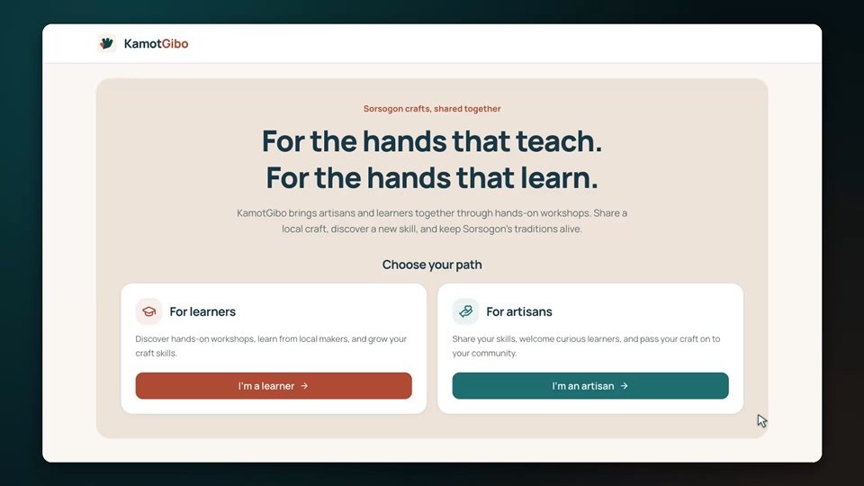

# KamotGibo

Full application codebase and cinematic demo: [fynchfries/KamotGibo](https://github.com/fynchfries/KamotGibo).

## Demo

[](https://github.com/fynchfries/KamotGibo/raw/refs/heads/main/kamotgibo-demo-cinematic.mp4)

[Open / download the cinematic demo](https://github.com/fynchfries/KamotGibo/raw/refs/heads/main/kamotgibo-demo-cinematic.mp4)

60 seconds · 1920×1080 · 30 fps · silent.

> Moving the GitHub repository does not reconnect Lovable automatically. Confirm the Lovable project is connected to this repository before expecting editor sync.

Implement exactly the screenshot and nothing else

This project was built with [Lovable](https://lovable.dev).

## Build with Lovable

Continue developing this project in the [Lovable editor](https://lovable.dev/projects/b6378923-2216-45c2-9170-ef60ee5e4765).

- **Ship faster**: describe what you want to build and Lovable handles the code.
- **Stay in sync**: every change made in Lovable is committed straight to this repository.
- **Full ownership**: this code is yours. Push to `main` on GitHub and your changes sync back into Lovable, ready for your next prompt.

## Development

Prefer working locally? You need Node.js and npm — [install with nvm](https://github.com/nvm-sh/nvm#installing-and-updating).

```sh
git clone https://github.com/fynchfries/KamotGibo.git
cd KamotGibo
npm i
npm run dev
```
